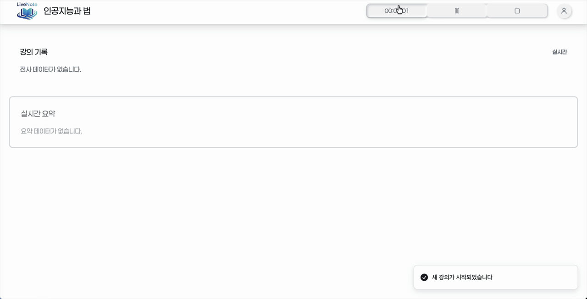
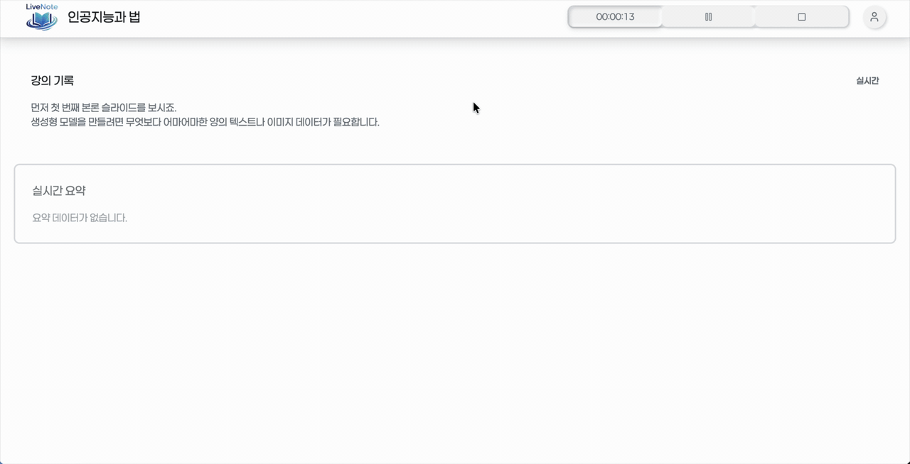
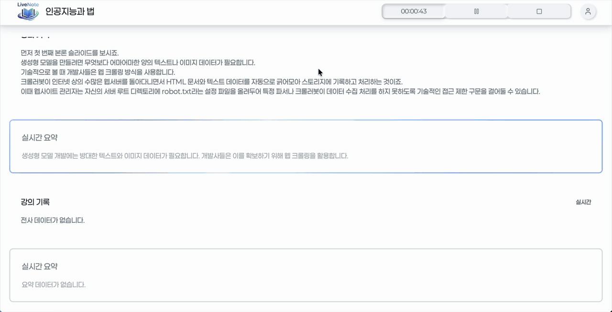
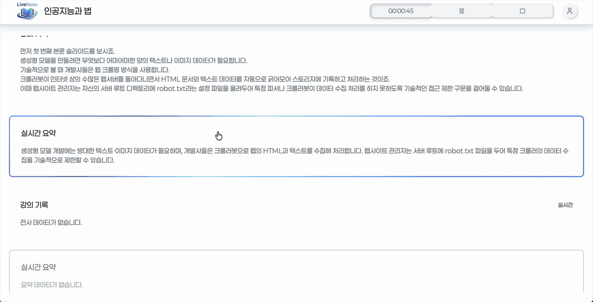
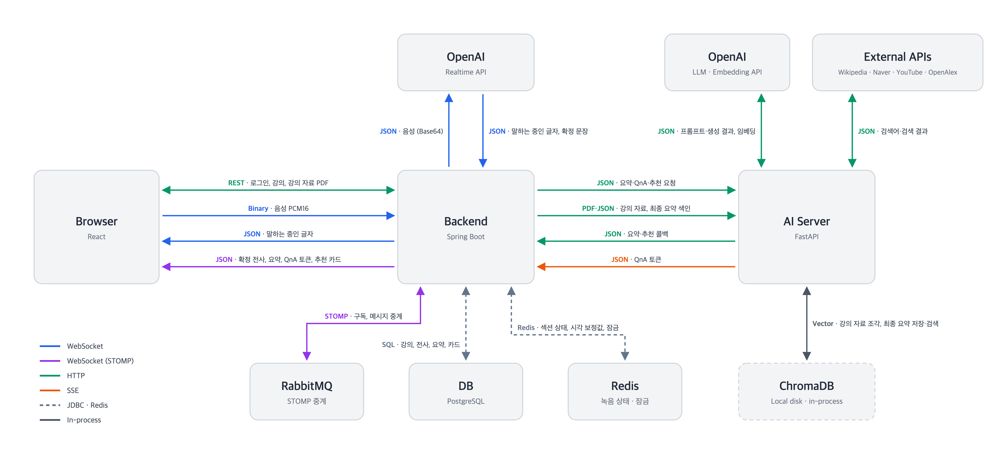
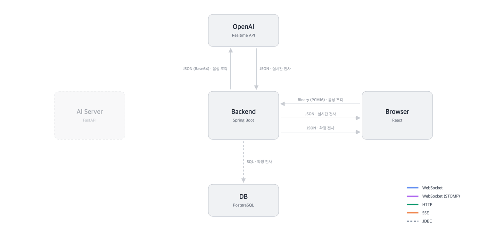
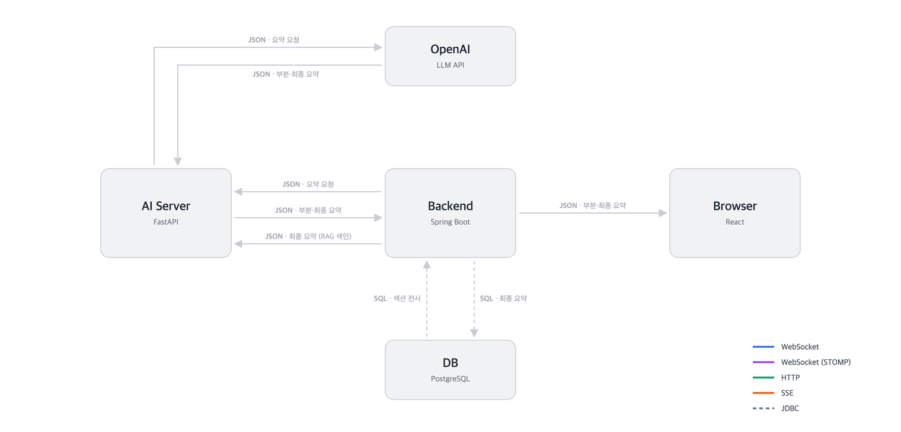
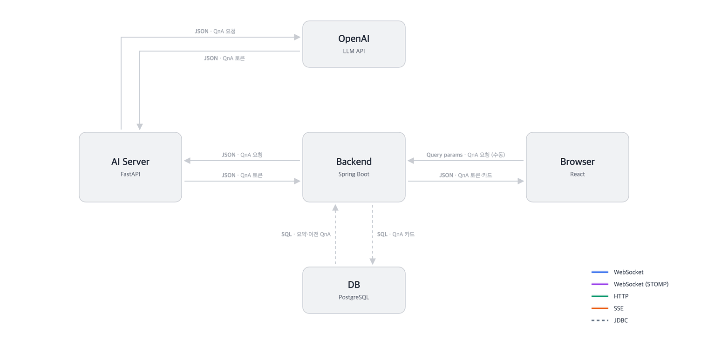
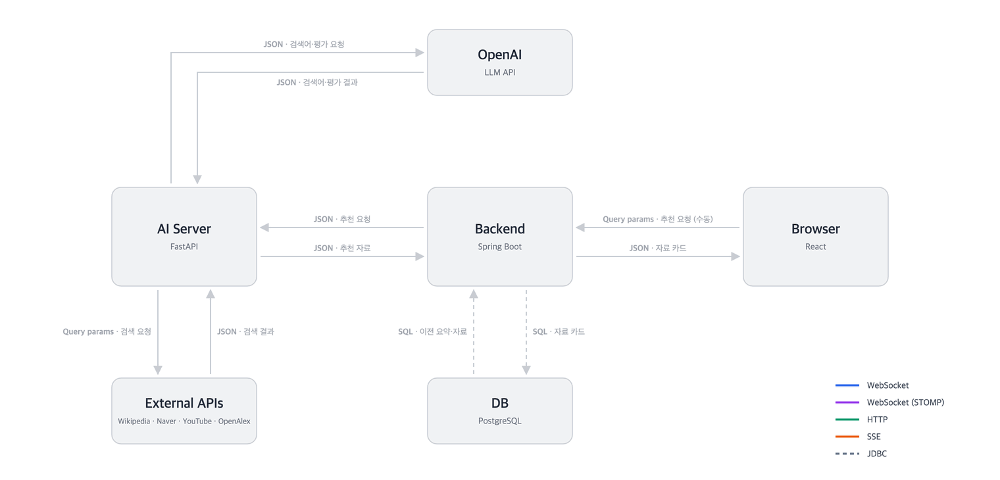

# LiveNote


---

## 목차

1. [개요](#1-개요)
2. [주요 기능](#2-주요-기능)
3. [시스템 아키텍처](#3-시스템-아키텍처)
4. [기술적 도전과 해결](#4-기술적-도전과-해결)
5. [성능 평가](#5-성능-평가)
6. [기술 스택](#6-기술-스택)
7. [실행 방법](#7-실행-방법)
8. [기타 문서](#8-기타-문서)

---

## 1. 개요

강의 중 모르는 개념이 나오면 검색어를 고민하거나 생성형 AI에 넣을 질문을 쓰게 됩니다.
그 사이에도 강의는 계속 진행되고, 돌아왔을 때는 이미 흐름을 놓친 상태가 됩니다.

LiveNote는 강의를 듣는 동안 전사, 요약, QnA, 자료 추천을 자동으로 보여줍니다. 미리 올린 강의 자료 PDF에서 관련 부분을 찾아 QnA와 자료 추천에도 반영합니다.

---

## 2. 주요 기능

### 실시간 전사



녹음 버튼만 누르면 교수님 말씀이 실시간으로 받아 적힙니다.

### 섹션 요약



강의 내용이 30초마다 한두 문장으로 요약됩니다. 잠깐 놓쳐도 요약만 보면 흐름을 따라잡을 수 있습니다.

### 원클릭 QnA



질문을 직접 쓰지 않아도 지금 내용에서 나올 만한 질문과 답변이 카드로 올라옵니다. 더 궁금하면 클릭 한 번으로 질문을 추가할 수 있습니다.

### 원클릭 자료 추천



검색어를 고민하지 않아도 지금 내용과 관련된 위키백과, 블로그 글이 카드로 올라옵니다. 클릭 한 번으로 YouTube 영상과 논문도 찾아볼 수 있습니다.

---

## 3. 시스템 아키텍처



| 구성 요소 | 기술 | 역할 |
| --- | --- | --- |
| 프론트엔드 [`frontend/`](frontend/README.md) | React, TypeScript, Vite | 녹음, 화면 표시 (:3000) |
| 백엔드 [`backend/`](backend/README.md) | Spring Boot | 인증, 강의 데이터, 전사 중계, 섹션 분할, AI 서버 호출 (:8080) |
| AI 서버 [`ai/`](ai/README.md) | FastAPI, LangChain·LangGraph | 요약, QnA, 자료 추천, 강의 자료 검색 (:8003) |
| OpenAI Realtime API | `gpt-transcribe` | 음성 실시간 전사 |
| RabbitMQ | STOMP 플러그인 | STOMP 구독과 메시지 중계 (:61613) |
| Redis | - | 녹음 상태(섹션, 시각 보정값)와 잠금 |
| PostgreSQL | - | 강의, 전사, 요약, 카드 저장 |
| ChromaDB | - | 강의 자료 조각과 최종 요약의 벡터 저장 |

- 브라우저 ↔ 백엔드: REST, 녹음 WebSocket(`/ws/transcription`), STOMP(`/ws`)
- 백엔드 ↔ AI 서버: HTTP. 요약·추천 결과는 콜백, QnA는 SSE 스트리밍. `X-Internal-Api-Key` 헤더로 인증
- 백엔드 ↔ OpenAI: Realtime API WebSocket으로 음성 중계

### 데이터 흐름

백엔드는 확정 문장의 발화 시작 시각을 기준으로 녹음을 30초 섹션으로 나누고, 섹션마다 다음 순서로 처리합니다.

| 시점 | 동작 |
| --- | --- |
| 0초 | 녹음 시작. 브라우저가 약 0.17초마다 음성을 백엔드로 보내고, 백엔드가 OpenAI로 중계 |
| 0 ~ 15초 | 말하는 중인 글자는 녹음자 화면에만 표시. 확정 문장은 DB 저장 후 STOMP로 모든 화면에 전송 |
| 15초 | 부분 요약(`PARTIAL`) 표시 후 QnA(`CONCEPT`, `APPLICATION`)와 자료 추천(`WIKI`, `BLOG`) 자동 요청 |
| 30초 | 최종 요약(`FINAL`) 저장과 표시, RAG 색인. 다음 섹션 시작 |

기능별 처리 흐름

<details>
<summary>실시간 전사</summary>



</details>

<details>
<summary>섹션 요약</summary>



</details>

<details>
<summary>QnA 생성</summary>



</details>

<details>
<summary>자료 추천</summary>



</details>

구간별 통신 방식과 데이터 형식은 [ARCHITECTURE.md](ARCHITECTURE.md)에 정리했습니다.

---

## 4. 기술적 도전과 해결

서비스를 만들며 마주친 문제와 그 해결 과정을 주제별로 정리했습니다.

| 문서 | 다룬 문제 |
| --- | --- |
| [강의 자료를 어떤 단위로 나눠야 정확하게 찾을 수 있는가](docs/challenges/01-chunking.md) | QnA와 자료 추천은 강의 자료 PDF에서 찾은 조각을 근거로 쓰는데, 글자 수로 자르면 조각이 문장 중간에서 끊깁니다 |
| [녹음과 화면 동기화를 어떻게 함께 처리할 것인가](docs/challenges/02-realtime-transcription.md) | 0.17초마다 올라오는 음성과 여러 화면에 맞춰야 하는 전사·요약·카드는 성격이 달라, 한 연결로 처리하면 녹음을 멈출 때 화면 동기화까지 끊깁니다 |
| [카드를 어떻게 강의 흐름에 늦지 않게 보여줄 것인가](docs/challenges/03-latency.md) | 카드가 늦게 나오면 강의는 이미 다음 내용으로 넘어가 있습니다 |

---

## 5. 성능 평가

| 측정 | 결과 | 표본 | 보고서 |
| --- | --- | --- | --- |
| 강의 자료 검색 Precision@4 | 88.5% (±2.7%p) | 133섹션, 판정 532건 | [E2_retrieval_test](ai/eval/results/E2_retrieval_test.md) |
| QnA Precision@4 | 88.8% (±4.0%p) | 60섹션, 판정 240건 | [E14_qna_test](ai/eval/results/E14_qna_test.md) |
| 자료 추천 Precision@4 | 87.5% (±5.9%p) | 30섹션, 판정 113건 | [E14_resource_test](ai/eval/results/E14_resource_test.md) |
| QnA 스트리밍 응답 시간 (중앙값) | 첫 질문 1,613ms, 전체 완료 2,753ms | 20섹션 × 질문 유형 4개 | [L_after](ai/eval/results/L_after.md) |
| 전사 글자 오류율 (CER) | 2.92% (`gpt-transcribe`) | 3강 | [T_transcription](ai/eval/results/T_transcription.md) |

측정 조건

- 데이터: 생성형 AI로 만든 강의 자료·스크립트를 `gpt-4o-mini-tts`로 읽은 합성 강의. 음성을 녹음 WebSocket에 실제 속도로 보내 서비스와 같은 경로로 전사·요약 수집
- Precision@4: 상위 4개 결과 중 관련 있는 비율. test 데이터 6강(공학, 간호, 예술·디자인 각 2강) 기준이며 괄호는 95% 신뢰구간
- 채점: `gpt-6.1-terra`의 관련/무관 이진 판정
- 응답 시간: AI 서버에 요청을 보낸 순간부터 SSE 이벤트 도착까지. 백엔드 중계와 브라우저 표시 시간 제외
- 전사 오류율: TTS에 쓴 원문 스크립트를 정답으로 사용. 영문 용어를 한글로 받아 적은 경우 등 표기 차이도 오류로 셈

평가 스크립트와 재현 방법은 [ai/README.md](ai/README.md#평가)에 있습니다.

---

## 6. 기술 스택

| 영역 | 기술 |
| --- | --- |
| 프론트엔드 |       |
| 백엔드 |     |
| AI |      |
| 메시징·저장소 |    |
| 외부 API |       |
| 개발 도구 |       |

---

## 7. 실행 방법

### 사전 요구사항

| 항목 | 버전·비고 |
| --- | --- |
| Node.js | 22 |
| Java | 17 |
| Python | 3.11 ([uv](https://docs.astral.sh/uv/) 필요. Python 3.11이 없으면 uv가 받음) |
| PostgreSQL | 17 |
| Redis | - |
| RabbitMQ | STOMP 플러그인(`rabbitmq_stomp`) 활성화 |
| API 키 | OpenAI, YouTube Data API v3, 네이버 블로그 검색 |

### 환경 설정

- AI 서버: `ai/.env` 작성. [ai/README.md 환경 설정](ai/README.md#환경-설정)
- 백엔드: `env.properties` 작성, PostgreSQL·Redis·RabbitMQ 준비. [backend/README.md 실행 방법](backend/README.md#실행-방법)
- 프론트엔드: 기본값으로 동작. [frontend/README.md 환경 설정](frontend/README.md#환경-설정)

AI 서버와 백엔드는 같은 `INTERNAL_API_KEY` 값을 사용합니다.

### 서버 실행

AI 서버 → 백엔드 → 프론트엔드 순서로 실행합니다.

```bash
cd ai && ./setup.sh && uv run uvicorn server.main:app --port 8003
cd backend && ./gradlew bootRun
cd frontend && npm install && npm run dev
```

브라우저에서 `http://localhost:3000`에 접속합니다.

### 테스트

```bash
cd ai && uv run pytest                                          # 외부 API 호출 없음
cd backend && ./gradlew test
cd frontend && npm run typecheck && npm run lint && npm test
```

---

## 8. 기타 문서

| 문서 | 내용 |
| --- | --- |
| [ARCHITECTURE.md](ARCHITECTURE.md) | 구간별 통신 방식, 데이터 형식, 0~30초 동작 시나리오 |
| [ai/README.md](ai/README.md) | AI 서버 실행, 환경 설정, 평가 |
| [ai/API_SPECIFICATION.md](ai/API_SPECIFICATION.md) | AI 서버 API 명세 |
| [backend/README.md](backend/README.md) | 백엔드 실행, 환경 설정, API 엔드포인트 |
| [frontend/README.md](frontend/README.md) | 프론트엔드 실행, 파일 구조 |
| [AGENTS.md](AGENTS.md) | 코드·커밋·PR 작성 규칙 |
| [캡스톤 최종 발표자료](캡스톤_발표4_3조%20_최종.pdf) | 캡스톤디자인 최종 발표 (PDF) |
