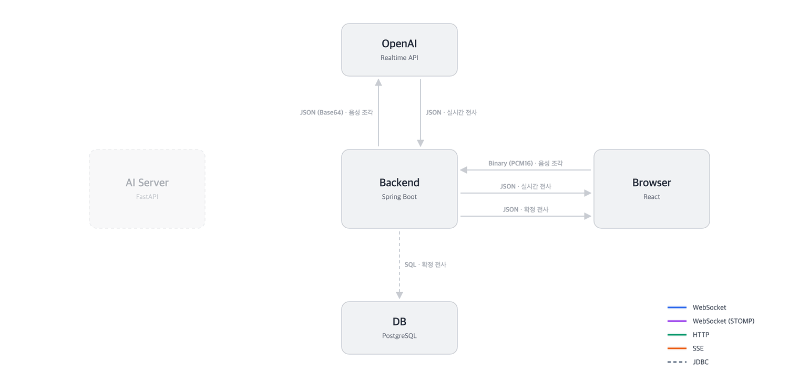

# 녹음과 화면 동기화를 어떻게 함께 처리할 것인가

## 목차
- [문제 상황](#문제-상황)
- [해결 방법](#해결-방법)
  - [1. 음성과 이벤트를 서로 다른 회선으로 보냅니다.](#1-음성과-이벤트를-서로-다른-회선으로-보냅니다)
  - [2. 말하는 중인 글자는 녹음자에게, 확정 문장은 모두에게 보냅니다.](#2-말하는-중인-글자는-녹음자에게-확정-문장은-모두에게-보냅니다)
  - [3. 이벤트는 RabbitMQ로 중계합니다.](#3-이벤트는-rabbitmq로-중계합니다)
  - [4. 녹음 상태는 서버 메모리가 아니라 Redis에 둡니다.](#4-녹음-상태는-서버-메모리가-아니라-redis에-둡니다)
  - [5. 같은 강의의 저장 작업은 Redis 잠금으로 하나씩 처리합니다.](#5-같은-강의의-저장-작업은-redis-잠금으로-하나씩-처리합니다)
- [효과](#효과)
- [관련 코드](#관련-코드)

## 문제 상황
- 강의 화면에는 성격이 다른 두 종류의 데이터가 오갑니다. 한 연결로 처리하면 녹음을 멈출 때 화면 동기화까지 끊깁니다.
> 음성은 녹음하는 브라우저에서 서버로 약 0.17초마다 올라오는 바이너리 조각(PCM16, 24kHz, 4096 샘플)입니다. 반면 확정 전사, 요약, QnA 토큰, 추천 카드는 서버에서 그 강의를 열어 둔 모든 화면에 내려가야 합니다. 둘을 STOMP 한 연결로 보내면 음성 조각마다 텍스트 헤더가 붙고, 녹음 시작·중지에 따라 이벤트 연결도 함께 열리고 닫힙니다.

## 해결 방법

### 1. 음성과 이벤트를 서로 다른 회선으로 보냅니다.

| 구분 | 녹음 WebSocket (`/ws/transcription`) | 이벤트 STOMP (`/ws`) |
| :--- | :--- | :--- |
| **프로토콜** | 순수 WebSocket | WebSocket 위의 STOMP |
| **대상** | 녹음자와 백엔드 1:1 | 백엔드와 구독자 1:N |
| **연결** | 녹음 시작 버튼을 누를 때 | 강의 화면에 들어올 때 |
| **종료** | 녹음 중지 (OpenAI 연결도 함께 종료) | 강의 화면을 나갈 때 |
| **주고받는 것** | 바이너리 음성 업로드, 말하는 중인 글자(`delta`) | 확정 전사, 요약, QnA 토큰, 추천 카드, 섹션 전환 |

- **수명 주기 분리** — 이벤트 회선은 강의 화면에 들어오는 순간 열려 화면을 나갈 때까지 유지됩니다. 녹음 회선은 녹음 버튼에 따라 따로 열리고 닫힙니다.
- **헤더 없는 음성 전송** — 녹음 회선은 순수 WebSocket이라 음성 조각을 바이너리 그대로 보냅니다.

### 2. 말하는 중인 글자는 녹음자에게, 확정 문장은 모두에게 보냅니다.

1. 브라우저가 마이크 음성을 PCM16으로 바꿔 녹음 WebSocket으로 보냅니다.
2. 백엔드가 음성을 Base64로 감싸 OpenAI Realtime API(전사 전용 세션)로 중계합니다.
3. OpenAI는 말하는 중에는 `delta`를, 0.5초 침묵으로 문장이 끝나면 `completed` 이벤트를 보냅니다.
4. `delta`는 녹음 WebSocket으로 녹음자 화면에 바로 표시합니다.
5. `completed` 문장은 섹션 번호를 붙여 DB에 저장한 뒤 STOMP `transcripts` 토픽으로 모든 구독자에게 보냅니다.
6. 섹션 발화가 15초, 30초에 이르면 AI 서버에 부분 요약과 최종 요약을 요청합니다.

### 3. 이벤트는 RabbitMQ로 중계합니다.

- **백엔드를 거치는 중계** — 브라우저는 RabbitMQ에 직접 연결하지 않고 백엔드 `/ws`에 연결합니다. `StompAuthChannelInterceptor`가 JWT와 강의 접근 권한을 확인한 뒤, 백엔드가 RabbitMQ STOMP 플러그인(`enableStompBrokerRelay`)으로 구독과 메시지를 중계합니다.
- **외부 브로커를 쓰는 이유** — 백엔드가 한 대일 때는 인메모리 브로커로도 동작합니다. 브로커를 RabbitMQ로 분리해, 백엔드를 여러 대로 늘렸을 때 다른 서버에 연결된 구독자에게도 메시지가 전달되도록 구성했습니다.
- **강의 주인만 구독** — 구독 요청마다 토픽 주소에서 강의 ID를 꺼내 본인 강의인지 확인하고, 아니면 거부합니다.
- **강의별 토픽** — 토픽은 `/topic/lectures.{id}.{이름}` 형식입니다. 종류는 `transcripts`, `summary`, `qna`, `resources`, `stream`, `section`, `error`입니다.

> [!NOTE]
> **토픽 주소에 왜 `/` 대신 `.`을 쓰나요?**
> RabbitMQ STOMP는 `/topic/` 뒤의 주소에 `/`를 허용하지 않습니다. `/topic/lectures/4/summary`는 `Invalid destination` 오류로 거부되므로 `/topic/lectures.4.summary`처럼 `.`으로 구분합니다.

- **녹음 회선 인증** — 브라우저 WebSocket은 헤더를 붙일 수 없어 로그인 토큰을 쿼리로 받고, 본인 강의가 아니면 연결을 끊습니다.

### 4. 녹음 상태는 서버 메모리가 아니라 Redis에 둡니다.

- **서버 사이에 공유되는 상태** — 서버 여러 대가 같은 상태를 보고, 서버가 재시작돼도 상태가 남도록 녹음 중인 강의의 상태를 Redis에 둡니다.

| 항목 | 내용 |
| :--- | :--- |
| **섹션 상태** | 섹션 번호, 섹션 시작·마지막 시각, 부분·최종 요약 요청 여부. 마지막 저장 후 12시간이 지나면 만료되고, 이때는 DB 기준으로 다시 만듦 |
| **시각 보정값** | 녹음을 멈췄다 다시 시작하면 브라우저 시각이 0부터 다시 시작하므로, 강의 전체 기준 시각으로 이어 붙이기 위한 값 |

### 5. 같은 강의의 저장 작업은 Redis 잠금으로 하나씩 처리합니다.

| 작업 | 잠금 단위 | 이유 |
| :--- | :--- | :--- |
| **확정 전사 저장** | 강의 | 섹션 상태를 읽고 고쳐 쓰는 사이 다른 전사가 끼어들면 섹션 번호가 어긋남 |
| **추천 카드 저장** | 강의·섹션 | 카드 번호를 기존 최댓값 다음으로 정하므로 동시에 처리하면 번호가 겹침 |
| **QnA 카드 저장** | 강의·섹션 | 같은 질문·답변을 중복 저장하지 않도록 기존 카드를 확인한 뒤 저장 |

- **본인 잠금만 해제** — 잠금은 최대 30초 유지되며, 해제할 때는 Lua 스크립트로 본인이 건 잠금인지 확인한 뒤 지웁니다. 다른 요청이 잡은 잠금을 실수로 지우지 않습니다.

## 효과

- **녹음과 관계없이 유지되는 화면 동기화**
  - 이벤트 회선이 강의 화면과 수명을 같이 하므로, 녹음을 멈추거나 다시 시작해도 요약과 카드는 끊기지 않고 들어옵니다.
  - 같은 계정으로 강의 화면을 연 다른 탭이나 기기도 녹음 여부와 관계없이 확정 전사, 요약, 카드를 함께 받습니다.

- **녹음자에게는 바로, 나머지 화면에는 확정본만**
  - 말하는 중인 글자는 녹음자 화면에만 바로 표시되고, 모든 구독자에게는 DB에 저장된 확정 문장만 전달됩니다.
  - 다른 화면에 고쳐 써질 미확정 글자가 오가지 않습니다.

- **녹음을 다시 시작해도 이어지는 기록**
  - 시각 보정값으로 재시작한 녹음의 전사가 강의 전체 시각에 이어 붙으므로, 섹션 번호와 시각이 처음부터 다시 시작되지 않습니다.

- **어긋나지 않는 섹션 번호와 카드 번호**
  - 같은 강의의 전사 저장과 같은 섹션의 카드 저장을 서버 여러 대에 걸쳐 하나씩 처리하므로, 동시에 들어온 요청 때문에 번호가 겹치거나 어긋나지 않습니다.

## 관련 코드

| 파일 | 내용 |
| :--- | :--- |
| [`useAudioRecording.ts`](../../frontend/src/features/session/audio/useAudioRecording.ts) | 마이크 녹음, 녹음 WebSocket 연결 |
| [`useSessionStream.ts`](../../frontend/src/features/session/realtime/useSessionStream.ts) | STOMP 연결과 토픽 구독 |
| [`RealtimeTranscriptionWebSocketHandler.java`](../../backend/src/main/java/com/capstone/livenote/recording/RealtimeTranscriptionWebSocketHandler.java) | 녹음 WebSocket 처리, OpenAI 중계 |
| [`OpenAiTranscriptionSession.java`](../../backend/src/main/java/com/capstone/livenote/recording/OpenAiTranscriptionSession.java) | OpenAI Realtime API 세션 |
| [`TranscriptService.java`](../../backend/src/main/java/com/capstone/livenote/recording/TranscriptService.java) | 확정 전사 저장과 전송 |
| [`SectionAggregationService.java`](../../backend/src/main/java/com/capstone/livenote/recording/SectionAggregationService.java) | 섹션 배정, 부분·최종 요약 요청 |
| [`RecordingStateStore.java`](../../backend/src/main/java/com/capstone/livenote/recording/RecordingStateStore.java) | Redis 섹션 상태와 시각 보정값 |
| [`RedisLock.java`](../../backend/src/main/java/com/capstone/livenote/global/redis/RedisLock.java) | Redis 잠금 |
| [`StompConfig.java`](../../backend/src/main/java/com/capstone/livenote/global/config/StompConfig.java) | STOMP 엔드포인트와 RabbitMQ 중계 설정 |
| [`StompAuthChannelInterceptor.java`](../../backend/src/main/java/com/capstone/livenote/global/security/StompAuthChannelInterceptor.java) | STOMP 인증과 강의 접근 권한 확인 |

구간별 메시지 형식은 [ARCHITECTURE.md](../../ARCHITECTURE.md)에 있습니다.
