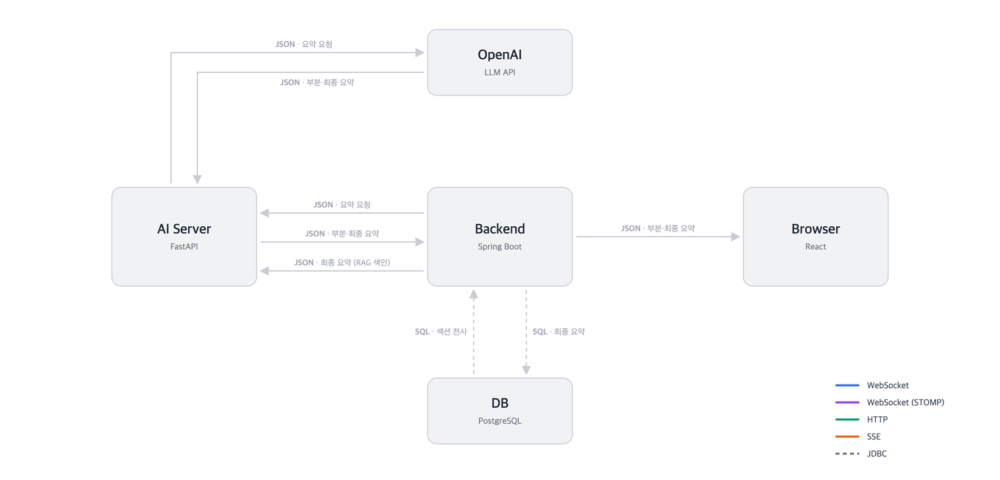
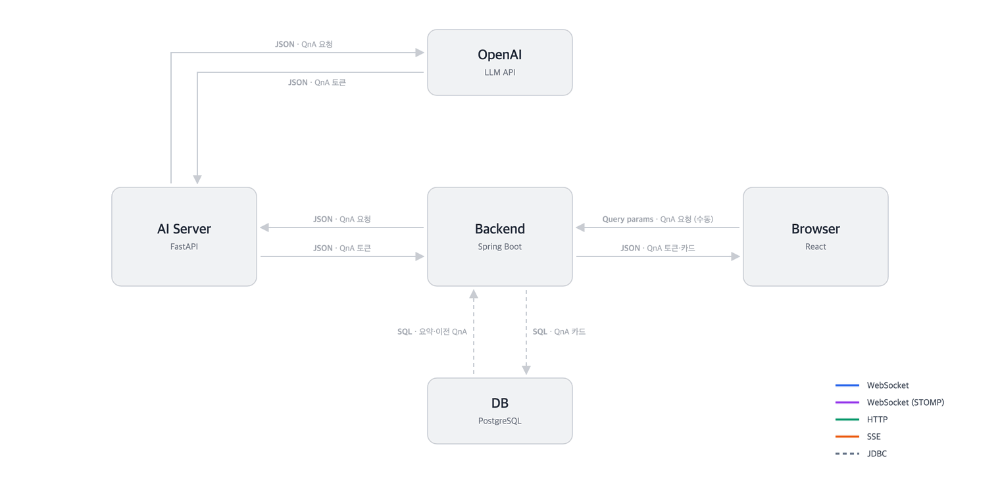

# 카드를 어떻게 강의 흐름에 늦지 않게 보여줄 것인가

## 목차
- [문제 상황](#문제-상황)
- [해결 방법](#해결-방법)
  - [1. 섹션 중간인 15초에 카드 생성을 시작합니다.](#1-섹션-중간인-15초에-카드-생성을-시작합니다)
  - [2. 질문 유형별 생성을 동시에 실행합니다.](#2-질문-유형별-생성을-동시에-실행합니다)
  - [3. 생성되는 대로 토큰 단위로 화면까지 보냅니다.](#3-생성되는-대로-토큰-단위로-화면까지-보냅니다)
  - [4. 추론 강도를 none으로 둡니다.](#4-추론-강도를-none으로-둡니다)
- [효과](#효과)
- [관련 코드](#관련-코드)

## 문제 상황
- QnA와 추천 카드는 지금 듣고 있는 내용에 대한 것이라, 늦게 나오면 강의는 이미 다음 내용으로 넘어가 있습니다.
> 녹음은 30초 섹션으로 나뉘고, 최종 요약은 섹션이 끝나는 30초에 나옵니다. 최종 요약을 기다렸다가 카드를 만들면 카드는 다음 섹션이 시작된 뒤에야 보입니다. 또 QnA를 질문과 답변까지 모두 만든 뒤 한꺼번에 보내면, 처음 보일 때까지 중앙값 3,799ms를 기다려야 합니다.

## 해결 방법

### 1. 섹션 중간인 15초에 카드 생성을 시작합니다.

1. 섹션 발화가 15초에 이르면 그때까지의 전사로 부분 요약(`PARTIAL`)을 요청합니다.
2. 부분 요약이 도착하면 DB에 저장하지 않고 화면에만 표시합니다.
3. 동시에 부분 요약으로 카드를 자동 요청합니다.
   - QnA: `CONCEPT`, `APPLICATION`
   - 자료 추천: `WIKI`, `BLOG`
4. 30초에 이르면 최종 요약(`FINAL`)을 저장하고 RAG 저장소에 색인합니다.
5. 사용자가 섹션 요약을 클릭하면 나머지 유형(질문 유형, `YOUTUBE`, `PAPER`)을 추가로 요청합니다.

- **저장하지 않는 부분 요약** — 부분 요약은 카드를 일찍 만들기 위한 중간 결과라 화면에만 보내고, 이후 섹션의 맥락으로 쓰는 것은 최종 요약뿐입니다.

### 2. 질문 유형별 생성을 동시에 실행합니다.

- **LangGraph 병렬 노드** — 질문 유형마다 생성 노드를 만들어 같은 단계에서 동시에 실행합니다. 유형이 늘어도 하나씩 차례로 기다리지 않습니다.
- **도착 순서대로 전달** — 각 노드는 진행 이벤트를 `get_stream_writer()`로 내보내고, 호출 쪽은 이를 도착 순서대로 받아 SSE로 보냅니다.

### 3. 생성되는 대로 토큰 단위로 화면까지 보냅니다.

- **SSE에서 STOMP로 이어지는 중계** — AI 서버는 QnA를 SSE 이벤트(`start`, `question`, `answer`, `done`, `error`)로 보냅니다. 백엔드는 응답 연결을 유지한 채 토큰을 받는 즉시 STOMP `stream` 토픽으로 넘기고, 항목이 끝나면 DB에 저장한 뒤 `qna` 토픽으로 전체 목록을 보냅니다.
- **측정** — 같은 요청을 보내 각 이벤트가 도착한 시각을 기록했습니다(추론 강도 `none`, 20섹션 × 질문 유형 4개).

| 지표 | 의미 | 중앙값 | p90 |
| :--- | :--- | :--- | :--- |
| **질문 표시** | 스트리밍에서 질문을 처음 읽을 수 있는 시각 | 1,670ms | 2,269ms |
| **첫 답변 조각** | 답변 첫 토큰 도착 | 1,732ms | 2,335ms |
| **항목 완료** | 항목별로 완성본을 보냈다면 처음 보였을 시각 | 3,220ms | 3,899ms |
| **전체 완료** | 모든 항목을 한 번에 보냈다면 처음 보였을 시각 | 3,799ms | 4,472ms |

> **시각은 어디서 어디까지인가?** — AI 서버에 요청을 보낸 순간부터 측정 도구가 SSE 이벤트를 받은 순간까지입니다. 백엔드 중계와 브라우저 표시 시간은 포함하지 않습니다(`eval.run_latency`).

### 4. 추론 강도를 none으로 둡니다.

- **같은 측정, 추론 강도만 변경** — QnA 생성 모델(`gpt-6-luna`)의 추론 강도만 바꿔 같은 방법으로 측정했습니다.

| 지표 (중앙값) | `low` | `none` |
| :--- | :--- | :--- |
| **질문 표시** | 3,345ms | 1,670ms |
| **첫 답변 조각** | 3,427ms | 1,732ms |
| **항목 완료** | 4,785ms | 3,220ms |
| **전체 완료** | 5,797ms | 3,799ms |

- 서비스 기본값은 `none`이며, `LLM_QA_REASONING_EFFORT`로 바꿀 수 있습니다.

## 효과

- **지금 듣고 있는 섹션 안에 도착하는 카드**
  - 시연 녹화(강의 1회)의 백엔드 로그에서 첫 섹션의 자동 QnA는 녹음 시작 후 약 19초에, 자동 추천 카드는 약 20초에 도착했습니다.
  - 같은 섹션의 최종 요약 요청은 약 41초였으므로, 최종 요약을 기다렸다면 카드는 그보다 뒤에 만들어지기 시작했을 것입니다.

- **2초 안에 읽기 시작하는 질문**
  - 질문을 처음 읽을 수 있는 시각은 중앙값 1,670ms로, 모든 항목을 한 번에 보낼 때(3,799ms)의 약 44% 시점입니다.
  - 답변 첫 토큰도 1,732ms에 도착해, 사용자는 답변이 써지는 것을 보며 기다립니다.

- **절반으로 줄어든 첫 표시 시각**
  - 추론 강도 `none`은 `low`보다 질문 표시가 3,345ms에서 1,670ms로, 전체 완료가 5,797ms에서 3,799ms로 줄었습니다.
  - 현재 설정의 QnA Precision@4는 88.8%입니다([E14_qna_test](../../ai/eval/results/E14_qna_test.md)).

보고서: [L_none](../../ai/eval/results/L_none.md) · [L_low](../../ai/eval/results/L_low.md)

## 관련 코드

| 파일 | 내용 |
| :--- | :--- |
| [`SectionAggregationService.java`](../../backend/src/main/java/com/capstone/livenote/recording/SectionAggregationService.java) | 15초·30초 요약 요청 |
| [`SummaryCallbackService.java`](../../backend/src/main/java/com/capstone/livenote/summary/SummaryCallbackService.java) | 부분 요약 도착 시 카드 자동 요청 |
| [`CardRequestService.java`](../../backend/src/main/java/com/capstone/livenote/card/CardRequestService.java) | 자동·추가 카드 요청 |
| [`QnaStreamService.java`](../../backend/src/main/java/com/capstone/livenote/card/QnaStreamService.java) | SSE 수신과 STOMP 중계 |
| [`ai/qa/graph.py`](../../ai/qa/graph.py) | 질문 유형별 동시 생성 (LangGraph) |
| [`ai/eval/run_latency.py`](../../ai/eval/run_latency.py) | 스트리밍 응답 시간 측정 |
